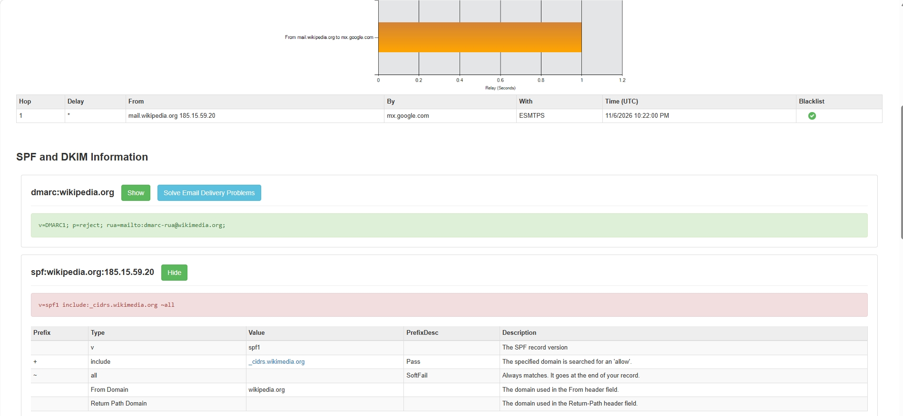
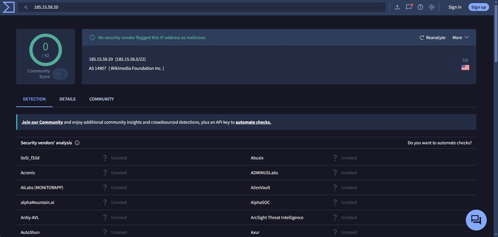
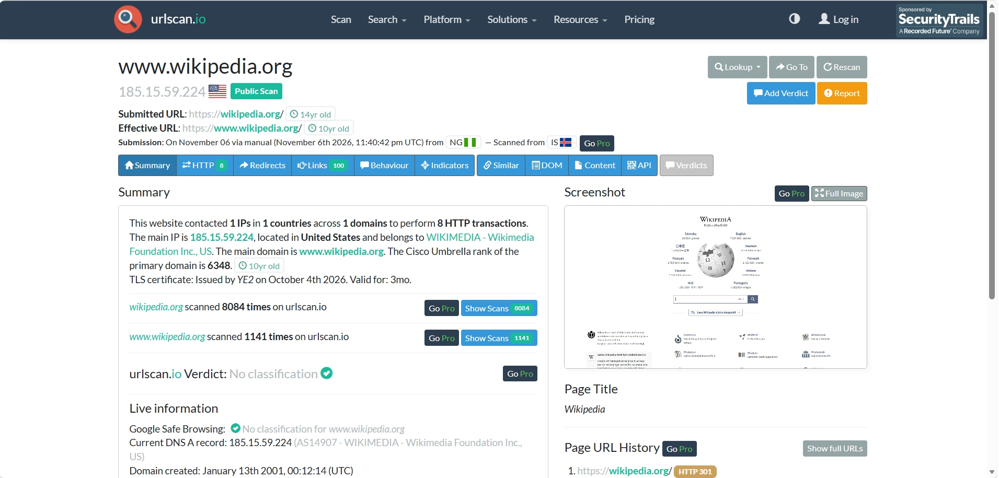

# Phishing Email & Threat Telemetry Analysis

## Executive Summary
This project demonstrates an end-to-end Incident Response triage procedure for a suspicious incoming email. Using open-source threat intelligence (OSINT) tools—including **MXToolbox**, **VirusTotal**, and **URLScan.io**—the analysis extracts email header routing data, evaluates originating IP reputation, and detonates embedded URLs in a secure sandbox environment.

---

## Technical Evidence Package

| Artifact Name | Tool | Scope of Investigation | Primary Finding |
| :--- | :--- | :--- | :--- |
| `01_header_analysis_mxtoolbox.png` | MXToolbox | Header Routing & Authentication | Extracted relay IP (`185.15.59.20`) and evaluated SPF/DMARC records. |
| `02_virustotal_ip_reputation.png` | VirusTotal | Threat Reputation | Checked threat intelligence vendor database for sender IP infrastructure (`Wikimedia Foundation Inc.`). |
| `03_urlscan_link_analysis.png` | URLScan.io | Link Detonation & Telemetry | Analyzed HTTP requests, DOM state, TLS details, and visual rendering of `https://wikipedia.org`. |

---

## Investigation Methodology

### Phase 1: Email Header & Authentication Analysis (MXToolbox)
- **Objective:** Analyze SMTP envelope hop path and authenticate domain validity.
- **Key Findings:**
  - **Originating Relay (Hop 1):** `mail.wikipedia.org` (`185.15.59.20`).
  - **SPF Evaluation:** Evaluated `v=spf1 include:_cidrs.wikimedia.org ~all` policy alignment.
  - **DMARC Evaluation:** Identified `p=reject` policy alignment for unauthorized sender enforcement.

---

### Phase 2: Originating Infrastructure Reputation (VirusTotal)
- **Objective:** Determine if the sender's IP address has historical associations with malicious activity or spam campaigns.
- **Key Findings:**
  - **Target IP:** `185.15.59.20`
  - **ASN Owner:** `AS14907` (Wikimedia Foundation Inc.)
  - **Detection Verdict:** `0/92` Security Vendor Flagged (Clean/Legitimate Infrastructure).

---

### Phase 3: URL Detonation & Web Telemetry (URLScan.io)
- **Objective:** Safely detonate embedded links to assess DOM behavior, TLS parameters, and redirection chains without exposing internal networks.
- **Key Findings:**
  - **Target URL:** `https://wikipedia.org`
  - **Primary IP Resolved:** `185.15.59.224`
  - **Certificate Issuer:** `YE2` (Valid TLS Encryption)
  - **Google Safe Browsing Status:** No classification for malicious activity.

---

## Incident Triage Conclusion & Recommendation

1. **Verdict:** **Benign / Legitimate Traffic**
2. **Analysis Summary:** The email routing paths match authorized sending infrastructure. SPF and DMARC checks align with domain policies, sender IP reputation is clean, and embedded link detonation confirmed non-malicious content.
3. **SOC Action Items:** 
   - No quarantine or blocklist action required.
   - Close incident ticket as **False Positive**.
